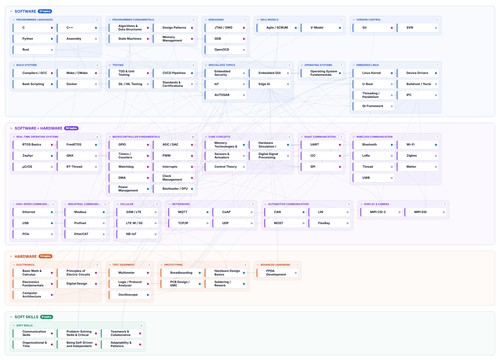

<div align="center">

# Naresh Yadav

<br/>

# 🗺️ Embedded Systems Engineering Roadmap

**An interactive learning platform that organizes everything you need to explore embedded systems engineering, in one place.**

[🌐 **Live Demo**](YOUR_LIVE_LINK)

</div>

---



## 📖 About

Hi, I'm **Naresh Yadav**, a 2nd year B.Tech student passionate about technology, electronics, programming and embedded systems.

I built this project to make the embedded engineering learning journey more **structured, understandable and accessible** for students and aspiring engineers. Instead of a long list of links, it shows how topics connect, which ones matter most, and where to learn each of them.

## ✨ Features

| | Feature | What it does |
|---|---|---|
| 🧭 | **Interactive roadmap** | 106 topics and 203 connections across Software, Hardware and Soft Skills. Zoom, pan, fit, full screen, collapse groups |
| 🔗 | **Relationship highlighting** | Click a topic to highlight what it connects to and why |
| 🎯 | **Priority filters** | Required, Recommended and Optional topics, with a clear legend |
| 📚 | **Resource library** | 800+ original resources: YouTube videos, playlists, channels, courses, books, docs and more |
| ▶️ | **In-site video preview** | Watch YouTube videos and playlists inside the site (official embed, with a fallback button) |
| 🔍 | **Global search** | `Ctrl + K` across topics, descriptions and resources, with filters |
| 🗂️ | **Outline view** | Full topic hierarchy, expand/collapse, search and export |
| 🛤️ | **7 learning paths** | Embedded Software, Hardware, Firmware, Embedded Linux, IoT, Automotive, RTOS |
| 🛠️ | **14 project ideas** | From LED blinking to CAN communication and Edge AI |
| ✅ | **Progress tracker** | Status, bookmarks and notes saved in your browser, with export and import |
| 📤 | **Export** | Roadmap as PNG, PDF or print; outline as Markdown; progress as JSON |
| 📱 | **Responsive** | Mobile gets expandable topic groups instead of the big graph |

## 🧰 Tech Stack

React 18 · TypeScript · Vite · Tailwind CSS · React Flow · Lucide React · html-to-image · jsPDF

No backend or database: everything runs from local JSON data.

## 🚀 Getting Started

```bash
# 1. Clone the repository
git clone https://github.com/naresh-yadav45/embedded-systems-roadmap.git
cd embedded-systems-roadmap

# 2. Install dependencies
npm install

# 3. Start the development server
npm run dev
```

Open `http://localhost:5173` in your browser.

### Other commands

| Command | Description |
|---|---|
| `npm run build` | Create the production build in `dist/` |
| `npm run preview` | Preview the production build locally |
| `npm run typecheck` | Run the TypeScript type check |
| `npm run build:data` | Regenerate JSON data from the reference README and map |
| `npm run check:links` | Check every resource link over HTTP (needs internet) |

## 📁 Project Structure

```
embedded-systems-roadmap/
├── reference/          # Original README, map.json and licence (source content)
├── scripts/            # Data builder and link checker
├── public/             # Favicon and social preview image
└── src/
    ├── components/     # Header, Hero, Roadmap, TopicPanel, Search, Outline,
    │                   # LearningPaths, ResourceLibrary, Projects, Progress, Footer
    ├── data/           # roadmap.json, resources.json, learningPaths.json, projects.json
    ├── lib/            # Data helpers, store, search, exporters
    ├── pages/          # 404 page
    └── types/          # TypeScript types
```

## 🧩 How the data works

- `reference/` holds the original roadmap README and `map.json`.
- `npm run build:data` parses them into `src/data/roadmap.json` and `resources.json`.
- Every link keeps its **original URL, title and topic associations**. Links are never silently removed. Anything with a structural problem is flagged as *needs verification* in `validation-report.json`.
- `learningPaths.json` and `projects.json` are hand-written and easy to extend.

## 🙏 Credits & License

The roadmap structure, topic descriptions, connections and learning resources are based on the open-source
**[Embedded Engineering Roadmap](https://github.com/m3y54m/Embedded-Engineering-Roadmap)** by **Meysam Parvizi**,
licensed under **[CC BY-SA 4.0](https://creativecommons.org/licenses/by-sa/4.0/)**.

The website interface, interactive graph, search, learning paths, progress tracker and exports are my own implementation on top of that content.
This project is shared under the same **CC BY-SA 4.0** licence (see [`LICENSE`](LICENSE)).

---

<div align="center">

**Designed & Developed with dedication by Naresh Yadav**

</div>
